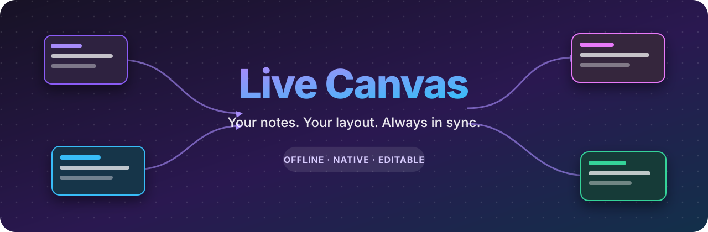

<p align="center">
  
</p>

<p align="center">
  <a href="https://obsidian.md"></a>
  
  
  
  
</p>

Live Canvas is an offline Obsidian community plugin that continuously synchronizes a normal, freely editable `.canvas` file with selected Markdown notes and their relationships.

Move or resize generated cards, add your own text, groups, links, files, and edges, then keep working. Refreshes update Live Canvas-managed items while preserving the rest of your Canvas.

## What it does

- Selects notes from an explicit folder or tag.
- Adds internal links, embeds, and linked properties as directed edges.
- Preserves manually moved and resized note cards during normal synchronization.
- Keeps manual Canvas nodes and valid manual edges.
- Expands the graph through incoming or outgoing linked neighbors.
- Excludes archive, draft, hidden, or other notes with simple rules.
- Colors cards by folder or tag and highlights isolated notes.
- Adds useful relationship labels such as `author`, `embed`, or Wikilink aliases.
- Offers an optional, confirmed smart relayout for managed cards.
- Updates after note changes or on demand.
- Runs locally with no server, account, API key, subscription, analytics, or telemetry.

## Install

Download `live-canvas-1.3.0.zip` from the latest GitHub release and extract it to:

```text
<your-vault>/.obsidian/plugins/live-canvas/
```

The folder must directly contain:

```text
main.js
manifest.json
styles.css
```

Restart Obsidian, open **Settings → Community plugins**, and enable **Live Canvas**. For step-by-step macOS, Windows, Linux, mobile, update, and uninstall instructions, read the [installation guide](docs/INSTALLATION.md).

## Quick start

1. Create a few notes in a folder such as `Knowledge` and connect them with `[[internal links]]`.
2. Open **Settings → Live Canvas**.
3. Choose **Folder** and enter `Knowledge`, or choose **Tag** and enter a tag such as `history`.
4. Keep the target path `Live Canvas.canvas`.
5. Select **Refresh and open**.
6. Move a card, edit a note, then run **Live Canvas: Refresh Canvas now**. The saved position should remain.

New to Canvas? The [beginner user guide](docs/USER_GUIDE.md) includes a complete first test and explains zooming, panning, moving, resizing, opening notes, and adding manual content.

## Example configuration

Exclude notes that should not appear:

```text
folder:Archive
tag:draft
property:status=archived
property:hidden
```

Color categories using Obsidian colors `1` through `6` or six-digit hex colors:

```text
folder:History = 1
tag:person = 4
tag:project/active = #4A90E2
```

See the [rules reference](docs/RULES_REFERENCE.md) for exact matching behavior.

## How synchronization stays safe

Live Canvas reads note metadata through Obsidian APIs and writes only the configured `.canvas` file. It never modifies or deletes Markdown notes.

An existing target Canvas is not overwritten automatically. You must choose **Adopt explicitly** before Live Canvas will manage it. Managed nodes and edges use dedicated internal IDs. Other valid nodes and edges remain. Writes use Obsidian's atomic vault processing API.

Normal synchronization preserves managed card positions and sizes. **Smart relayout** is separate, requires confirmation, moves only managed cards, and leaves manual nodes in place.

Back up an important vault before testing any community plugin.

## Feature details

| Area | Behavior |
| --- | --- |
| Sources | Folder, whole vault, or tag including nested tags |
| Relationships | Wikilinks, resolved Markdown links, embeds, linked properties |
| Expansion | Zero, one, or two hops; incoming, outgoing, or both |
| Layout | Deterministic initial placement; optional smart relayout |
| Preservation | Managed geometry, manual nodes, and valid manual edges |
| Styling | First-match folder/tag rules plus isolated-note highlighting |
| Refresh | Startup, debounced note changes, ribbon, command, or settings |
| Privacy | Local-only; no network access or telemetry |

## Commands

- **Refresh Canvas now** — synchronize immediately.
- **Open managed Canvas** — open the configured Canvas.
- **Smart relayout managed cards** — confirm and rearrange generated note cards.

## Documentation

- [Installation](docs/INSTALLATION.md)
- [Beginner user guide](docs/USER_GUIDE.md)
- [Filter and color rules](docs/RULES_REFERENCE.md)
- [Troubleshooting](docs/TROUBLESHOOTING.md)
- [Privacy](docs/PRIVACY.md)
- [Development](docs/DEVELOPMENT.md)
- [Publish the repository on GitHub](docs/PUBLISHING_TO_GITHUB.md)
- [Release and GitHub setup](docs/RELEASING.md)
- [Changelog](CHANGELOG.md)
- [Support](SUPPORT.md)

The repository also contains a small [demo note set](examples/demo-vault/README.md) that can be copied into a test vault.

## Limitations

- Live sync runs only while Obsidian and the plugin are active.
- Unresolved or ambiguous links are ignored.
- Multiple links in the same direction between two notes become one edge.
- Obsidian must save a moved card before a refresh can preserve its new position.
- A note renamed outside a running Obsidian session cannot always be matched to its former card.
- Very large Canvas files may become slow; use focused filters and the safety limit.
- Smart relayout is deterministic and connection-based, not a physics simulation.

## Development

Requires Node.js 18 or newer.

```bash
npm ci
npm run check
npm run package
```

The production bundle is written to `main.js`. Packaging creates an install ZIP, a source archive, and a clean GitHub repository archive. See the [development guide](docs/DEVELOPMENT.md) for the full workflow.

## Contributing and security

Contributions are welcome. Read [CONTRIBUTING.md](CONTRIBUTING.md) before opening a pull request. Use the structured issue forms for bugs and features. Please report sensitive vulnerabilities privately as described in [SECURITY.md](SECURITY.md).

## Project principles

Future changes should keep Live Canvas:

- local-first and usable offline;
- compatible with native, editable Canvas files;
- conservative with user-created content;
- understandable without a technical background;
- useful without accounts, subscriptions, or external services.

## License

Live Canvas is available under the [MIT License](LICENSE).
